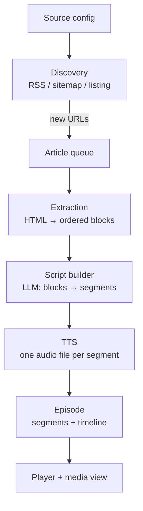
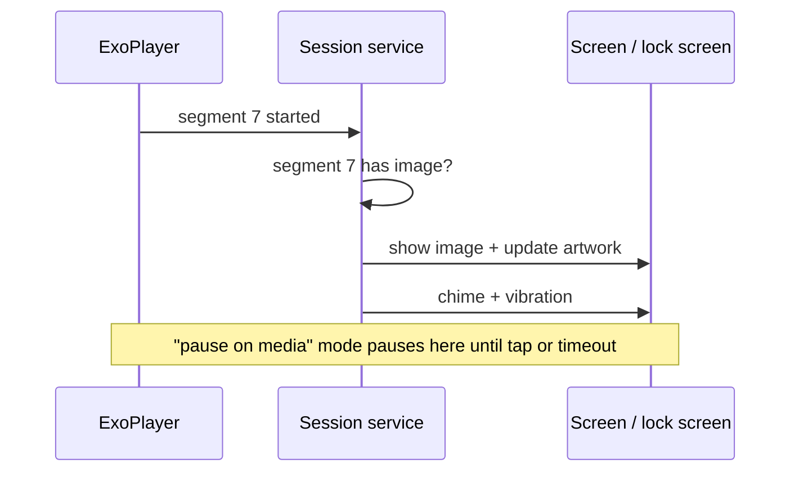
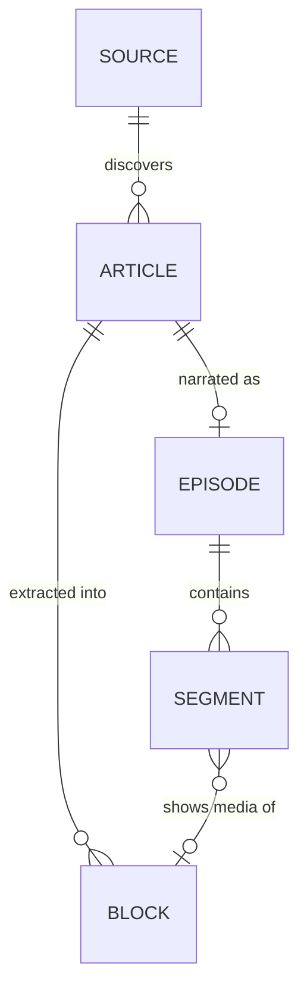

# Architecture

Everything runs on the phone. It calls cloud APIs for the LLM and the TTS. There's no backend to host, and the API keys are yours.

The generation pipeline sits behind its own module with no Android UI dependencies. If background generation on the phone becomes a problem (battery, Doze, sync across devices), it can move to a server later.

## Pipeline

Each stage writes its result to the database. A failure retries that stage only, never the whole article.

## Components

### Source adapters

Each source has a type, a URL, and optional filters. The adapter returns article URLs it hasn't seen before.

| Adapter | Detects new posts by | Used when |
|---|---|---|
| RSS/Atom | Feed items not seen before | The site has a feed |
| Sitemap | URLs matching a path prefix not seen before | No feed, but a sitemap exists |
| Listing | Links matching a CSS selector on a listing page | Neither of the above |

Auto-detection tries these in order when you add a source.

**Anthropic preset.** It has no feed: `/rss.xml`, `/feed`, and `/feed.xml` all return 404. It uses the sitemap adapter on `https://www.anthropic.com/sitemap.xml` with prefix `/research/`. The `lastmod` dates can't be trusted for ordering because bulk edits give many entries the same timestamp. So the adapter diffs the URL set, and the publish date comes from the article page itself.

On the first sync, a source only imports its newest N articles (default 5). Otherwise the queue would fill with the whole archive.

### Extraction

- Fetch the article HTML and keep the main content with a Readability port.
- Walk the DOM into typed blocks: `heading`, `paragraph`, `image`, `caption`, `quote`, `code`, `table`, `video`, `list`.
- Pair images with their captions and alt text. Resolve them to absolute URLs and download them.
- A source can override extraction with CSS selectors when Readability gets it wrong.

### Script builder

The LLM gets the blocks and returns narration segments as structured JSON. Each segment has spoken text and an optional reference to a media block.

- **Faithful by default.** Paragraphs stay close to the original. Only listening-hostile content gets rewritten: URLs, footnote markers, code, tables.
- **Image descriptions.** The image goes to the model through vision together with its caption, so the description matches what the image really shows.
- **Media cue.** A segment that references an image starts with a short spoken pointer, for example "There's a chart on screen."
- **Long articles** go in chunks by section, so one request never grows too large.

Claude through the Anthropic API is the first provider. The model is configurable, with a cheaper model for plain text and a stronger one for vision.

### TTS

- Synthesize **one audio file per segment**. Each segment's start time is the sum of the durations before it. That gives the image timeline without needing word-level timestamps.
- Providers sit behind one interface. Android's built-in `TextToSpeech` works offline as a free fallback, and a cloud voice gives the quality.
- Retrying one failed segment is cheap.

### Player

- Media3 `ExoPlayer` plays the segment files as a gapless playlist, inside a `MediaSessionService`. That gives you background playback, lock screen, Bluetooth controls, and Android Auto later.
- On every segment change, the UI shows that segment's image, or keeps the last one visible.
- When a segment has media, the app plays a chime, vibrates, and sets the image as the session artwork so it shows on the lock screen.

## Data Model

- `Article.status` tracks the pipeline: `discovered → extracted → scripted → synthesized → ready`, or `failed` with the stage and the error.
- `Episode` stores playback position and played state.
- Audio and images live in app storage. A cleanup job deletes them N days after an episode is played.

## Tech Stack

| Concern | Choice |
|---|---|
| Language / UI | Kotlin, Jetpack Compose |
| Playback | Media3 (ExoPlayer, MediaSession) |
| Background work | WorkManager: periodic discovery plus a chained job per article |
| Storage | Room |
| HTTP / parsing | OkHttp, jsoup, Readability4J |
| Images | Coil |
| DI | Hilt |
| Secrets | Android Keystore-backed encrypted storage for API keys |

## Key Decisions

- **On-device, no backend.** It's a personal app, and a server adds hosting and auth for one user.
- **Segment-level sync, not word-level.** Images only need to change at paragraph boundaries. This keeps every TTS provider usable.
- **Generate ahead of time, not while streaming.** Episodes are ready before you press play, so playback works offline and never stalls.
