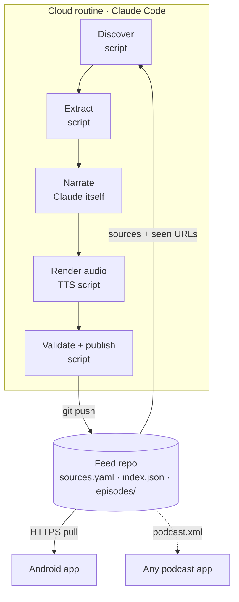
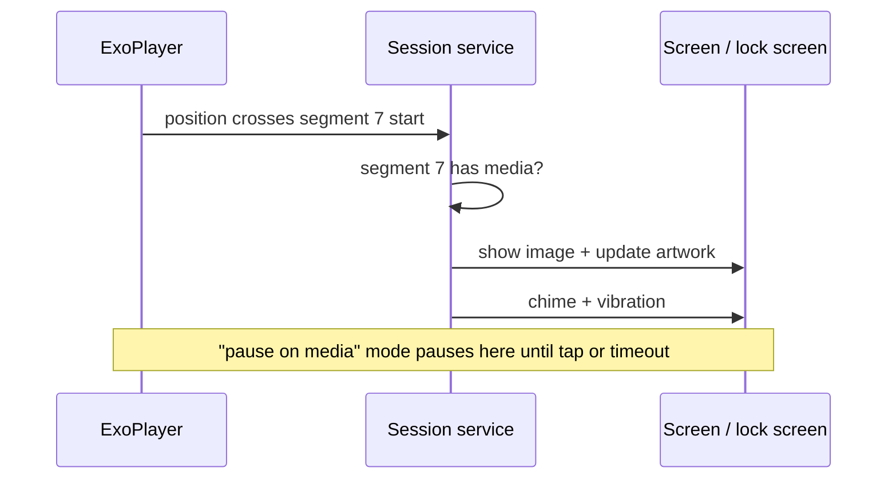

# Architecture

There are three parts:

- **Generator.** A scheduled Claude Code cloud routine that runs on your Anthropic subscription. It turns new articles into presentations.
- **Feed repo.** A private GitHub repo that holds the presentations. The phone reads it like a podcast feed.
- **App.** An Android player. It doesn't generate anything. It downloads presentations and plays them.

## Repos

| Repo | Holds |
| --- | --- |
| `audio-presenter` (this one) | Docs, generator scripts and skill, Android app |
| `audio-presenter-feed` (private) | `sources.yaml`, the list of seen URLs per source, `index.json`, `podcast.xml`, one folder per episode |

Keeping the binary audio out of this repo keeps its history small. Audio is compressed to mono Opus or AAC at about 32 kbps, roughly 0.25 MB per minute. If the feed repo grows too large, a cleanup step drops episodes older than a retention window.

## Generator

Claude only does the part that needs judgment: writing the narration. Everything else is a deterministic script that Claude runs, so runs are repeatable and cheap on subscription usage.

### Discover

- Reads `sources.yaml` and the seen-URL state from the feed repo. Returns new article URLs.
- Uses one adapter per source type:

| Adapter | Detects new posts by | Used when |
| --- | --- | --- |
| RSS/Atom | Feed items not seen before | The site has a feed |
| Sitemap | URLs matching a path prefix not seen before | No feed, but a sitemap exists |
| Listing | Links matching a CSS selector on a listing page | Neither of the above |

- On a source's first run, it only takes the newest N articles (default 5). Otherwise the queue would fill with the whole archive.
- Takes at most M articles per run, to cap subscription usage.

**Anthropic research.** The site has no feed: `/rss.xml`, `/feed`, and `/feed.xml` all return 404. The generator uses the sitemap adapter on `https://www.anthropic.com/sitemap.xml` with prefix `/research/`. The `lastmod` dates can't be trusted for ordering because bulk edits give many entries the same timestamp. So the adapter compares the set of URLs, and the publish date comes from the article page itself.

### Extract

- Keeps the main content with a Readability-style extractor. A source can override this with CSS selectors.
- Writes ordered blocks (`heading`, `paragraph`, `image`, `caption`, `quote`, `code`, `table`, `list`, `video`) to `article.json`.
- Downloads images and converts them to WebP, with captions and alt text attached.

### Narrate

A repo skill tells Claude how to turn `article.json` into narration segments:

- Stay faithful to the original. Only rewrite what doesn't work when spoken: URLs, footnote markers, code, tables.
- Open the downloaded images and describe what they actually show.
- Start each media segment with a short spoken pointer, for example "There's a chart on screen."

Claude writes `script.json`, and a JSON schema check rejects malformed output before audio is rendered.

### Render audio

- Renders each segment to speech, then joins the segments into one audio file. Segment start times come from the measured durations.
- Uses one TTS interface with two backends: a local open model or a paid API. The [TTS spike](roadmap.md#m0--spikes) picks one.
- A paid API needs its key stored as a routine secret.

### Validate and publish

- Writes `presentation.json` and checks it against the schema.
- Updates `index.json`, `podcast.xml`, and the seen-URL state.
- Commits and pushes to the feed repo. One commit per run.

### Failures

- A failed article is logged in the run state and retried on the next run, up to 3 attempts.
- A failure in one article never blocks the others.

## Podcast Export

Each run also writes `podcast.xml`, a standard podcast RSS feed with [Podcasting 2.0 chapters](https://github.com/Podcastindex-org/podcast-namespace/blob/main/chapters/jsonChapters.md). Each chapter can carry an image. That gives synced images in an existing Android podcast app such as AntennaPod before our app exists.

Our app still adds the chime and vibration cue, pause-on-media, and the transcript.

## App

- Polls `index.json` with an ETag on a WorkManager schedule. Downloads new episodes in full for offline playback.
- Reads the private repo with a fine-grained GitHub token that has read-only access to contents, stored in Keystore-backed encrypted storage.
- Media3 `ExoPlayer` inside a `MediaSessionService` handles background playback, the lock screen, Bluetooth, and Android Auto later.
- A position listener maps playback time to the current segment. When a segment brings new media, the app shows the image, sets it as the session artwork, then chimes and vibrates.

| Concern | Choice |
| --- | --- |
| Language / UI | Kotlin, Jetpack Compose |
| Playback | Media3 (ExoPlayer, MediaSession) |
| Sync | WorkManager, OkHttp |
| Storage | Room for queue and playback state. Files in app storage. |
| Images | Coil |
| DI | Hilt |

## Key Decisions

- **Generation runs in the cloud, on your subscription.** The routine runs with your PC off and needs no Anthropic API key.
- **TTS runs on the generator, never on the phone.** Phone voices aren't good enough.
- **Scripts do the mechanical work, Claude does the writing.** Runs are cheaper, repeatable, and easier to debug.
- **GitHub is the delivery channel.** No server to host. Git history doubles as an audit log of every run.
- **One audio file plus a timeline.** The format works in a plain podcast app, and our app layers the sync on top.
