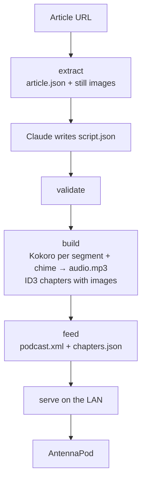

# Architecture

The core is a pipeline that turns one article URL into one podcast episode. It runs on the PC, driven by Claude Code on your Anthropic subscription. Sources, scheduling, and hosting come later, as layers around it.

Claude only does the step that needs judgment: writing the narration. Everything else is the `audio-presenter` CLI in [src/audio_presenter](../src/audio_presenter). The [article-to-podcast skill](../skills/article-to-podcast/SKILL.md) runs the whole flow and holds the narration rules. It ships as the `pagecast` Claude Code plugin, with a [setup skill](../skills/setup/SKILL.md) that installs and checks the environment.

## Steps

### extract

- A custom BeautifulSoup walker over the content root, which is the element with the most direct `
` children. It also walks that element's siblings, which catches bylines.
- Writes ordered blocks to `article.json`: `heading`, `paragraph`, `list`, `quote`, `code`, `table`, and `media`, which points to an entry in `media`. Also writes title, site, publish date, and footnotes.
- Saves a still JPEG per media item for chapter art:
  - Images: as they are.
  - GIFs: their last frame, which usually shows the animation's final state.
  - Videos: a frame grabbed from the URL with ffmpeg. That's the end of a looping animation, or the middle of a demo.

Anthropic pages are well-structured, and the extractor relies on that:

- Tables are `
` grids with ARIA rows and cells. None of the 220 research posts uses a `<table>` element.
- Footnote markers are `role="doc-noteref"`. They become `[^n]` in the text, and the notes go in `footnotes`.
- Image `alt` text is often empty, so captions are the main description. Newer posts have descriptive `alt` text.
- It drops the table of contents (shown 3 times), BibTeX citation `<pre>` blocks, related-post asides, and buttons.

### validate

Checks `script.json` against [the schema](../src/audio_presenter/schemas/script.schema.json). It also checks that every media reference has a still, and that `s1` is the title. It warns about stills that never get shown.

### build

- **Render.** Kokoro `af_heart` reads each segment separately. A two-note chime and a 0.25 s gap come before every segment with media. A pause follows each segment: 1.0 s after the title, 0.8 s after headings, and 0.6 s otherwise.
- **Encode.** ffmpeg normalizes loudness to −16 LUFS and writes a 96 kbps mono MP3. Segment times come from the clip lengths, and get written to `presentation.json`.
- **Package.** Builds the chapters and embeds them as ID3v2.3 `CHAP` and `CTOC` frames, each with its image, using mutagen.

### feed and serve

- `feed` writes `podcast.xml` and each episode's `chapters.json`, with absolute URLs for the LAN address.
- `serve` rebuilds the feed and serves `output/` on port 8000. Python's file server doesn't support HTTP range requests, so download episodes in AntennaPod rather than streaming them.
- Pocket Casts needs public hosting, because it fetches feeds through its own servers. That waits for the hosting layer.

## Tooling

| Concern | Choice |
| --- | --- |
| Language | Python 3.12 with uv. Kokoro doesn't support 3.13 yet. |
| TTS | Kokoro-82M, voice `af_heart`, on CUDA. A 34-minute article renders in under a minute. |
| Audio | ffmpeg |
| ID3 chapters | mutagen |
| Narration | Claude Code skill |

## Later Layers

- **Sources.** RSS/Atom, sitemap, and listing-page adapters that find new article URLs. Anthropic research has no feed: `/rss.xml`, `/feed`, and `/feed.xml` all return 404. So it uses the sitemap at `https://www.anthropic.com/sitemap.xml`, filtered to `/research/`, and compares the set of URLs between checks. The `lastmod` dates can't be used because bulk edits give many entries the same timestamp.
- **Scheduled routine.** A Claude Code cloud routine that runs the same pipeline on new URLs. Kokoro runs on CPU too, so it can run in the cloud.
- **Hosting.** A private feed you can reach from anywhere.
- **Own player.** Adds vibration on images and pause-on-media. Built on the same `presentation.json`.

## Key Decisions

- **Existing podcast apps first.** They already handle the queue, background playback, and offline listening, and they show chapter images.
- **MP3 with ID3 chapters.** Pocket Casts on Android reads MP3 chapters but not M4A chapters. AntennaPod reads both.
- **Chime in the audio.** It works in every player, so the "look now" cue doesn't need our own app.
- **One segment per paragraph.** Images switch at paragraph boundaries, and a failed segment re-renders on its own.
- **A custom extractor, not trafilatura or readability.** Those drop `role="table"` grids and lose where media sits in the text.
