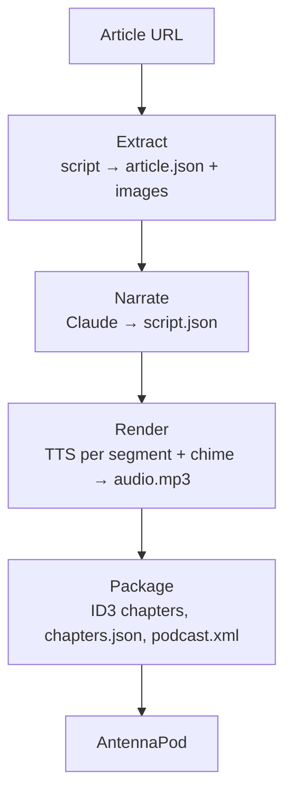

# Architecture

The core is a pipeline that turns one article URL into one podcast episode. It runs on the PC, driven by Claude Code on your Anthropic subscription. Sources, scheduling, and hosting come later, as layers around it.

Claude only does the step that needs judgment: writing the narration. Every other step is a deterministic Python script. Claude runs them from one command, `/article-to-podcast <url>`, so runs are repeatable and easy to debug.

## Steps

### Extract

- Fetches the page and keeps the main content. The extractor library gets picked by testing on Anthropic posts: trafilatura or readability-lxml.
- Writes ordered blocks (`heading`, `paragraph`, `image`, `caption`, `quote`, `code`, `table`, `list`, `video`) to `article.json`, with title, authors, and publish date.
- Downloads images and pairs them with their captions and alt text.

Things to handle on Anthropic pages:

- Tables are grids of `
` cells, with no `<table>` element. Across all 220 research posts, not one uses `<table>`.
- Image `alt` text is usually empty, so captions are the only description.
- Boilerplate to drop: the table of contents (it shows up 3 times), the BibTeX citation `<pre>`, topic tags, and related-post links.
- Videos come as `<video>` elements, either demos with controls or looping animations. Some posts also use GIFs and `<iframe>` embeds.

### Narrate

A repo skill tells Claude how to turn `article.json` into `script.json`:

- One segment per paragraph or equivalent block.
- Stay faithful to the original. Only rewrite what doesn't work when spoken: URLs, footnote markers, code, tables.
- Open each image and describe what it actually shows.
- Start each image segment with a short spoken pointer, for example "There's a chart on screen."

A JSON schema check rejects malformed output before any audio is rendered.

### Render

- Renders each segment to its own audio clip, with the TTS engine picked in the [TTS spike](spikes/tts.md).
- Mixes a short chime before every segment that brings a new image.
- Joins the clips with a fixed pause between them, then encodes one MP3. Segment start times come from the measured clip durations.
- Reads only `script.json`, so changing the voice means rendering again without calling Claude.

### Package

- Writes `presentation.json` with the full timeline.
- Embeds ID3 chapters into the MP3 (`CHAP` + `CTOC` frames, with an `APIC` image per chapter) using mutagen.
- Writes `chapters.json` (Podcasting 2.0 format) and a `podcast.xml` feed that lists every episode in the output folder.

See [presentation-format.md](presentation-format.md) for the files and the chapter rules.

### Deliver

- AntennaPod subscribes to `podcast.xml`, served over the LAN with `python -m http.server`. Or it can read the MP3s from a local folder on the phone.
- Pocket Casts can't use either option. It refreshes feeds through its own servers, so it needs public hosting. That waits for the hosting layer.

## Tooling

| Concern | Choice |
| --- | --- |
| Language | Python 3.13 with uv |
| Audio | ffmpeg (joining, loudness normalization, MP3 encoding) |
| ID3 chapters | mutagen |
| Narration | Claude Code skill + slash command |
| TTS | Picked in the spike. The local GPU is an RTX 5080 Laptop with 16 GB of VRAM. |

## Later Layers

- **Sources.** RSS/Atom, sitemap, and listing-page adapters that find new article URLs. Anthropic research has no feed: `/rss.xml`, `/feed`, and `/feed.xml` all return 404. So it uses the sitemap at `https://www.anthropic.com/sitemap.xml`, filtered to `/research/`, and compares the set of URLs between checks. The `lastmod` dates can't be used because bulk edits give many entries the same timestamp.
- **Scheduled routine.** A Claude Code cloud routine that runs the same pipeline on new URLs. It needs a TTS that runs in the cloud, which the spike should keep in mind.
- **Hosting.** A private feed you can reach from anywhere.
- **Own player.** Adds vibration on images and pause-on-media. Built on the same `presentation.json`.

## Key Decisions

- **Existing podcast apps first.** They already handle the queue, background playback, and offline listening, and they show chapter images.
- **MP3 with ID3 chapters.** Pocket Casts on Android reads MP3 chapters but not M4A chapters. AntennaPod reads both.
- **Chime in the audio.** It works in every player, so the "look now" cue doesn't need our own app.
- **One segment per paragraph.** Images switch at paragraph boundaries, and a failed segment re-renders on its own.
