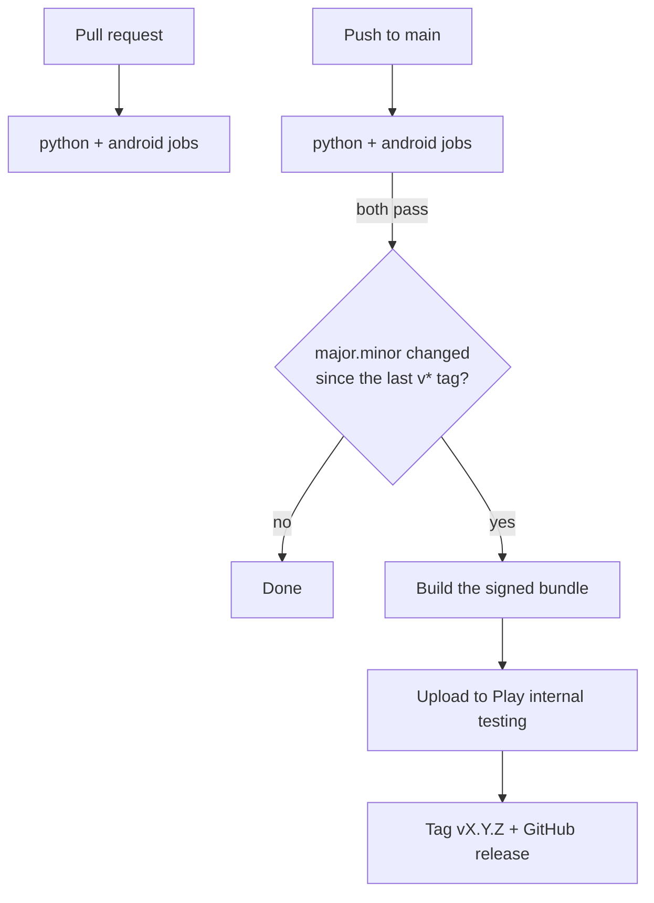

# Build and Release

One workflow, [ci.yml](../.github/workflows/ci.yml), builds and tests every PR and every push to main. On main, a major or minor version bump also ships the app to Google Play's internal testing track.



## Jobs

| Job | Runs | What it checks |
| --- | --- | --- |
| Python tests | PRs and main | `pytest`, without the `tts` group, so PyTorch never downloads |
| Android build and test | PRs and main | `lintDebug`, `testDebugUnitTest`, `assembleDebug` |
| Release to Google Play | main, after both pass | See below |

Jobs run on a self-hosted runner when the repo's `CI_RUNNER` variable names one, and on GitHub-hosted runners otherwise. Pull requests from forks always run on GitHub-hosted runners, and their workflows wait for a maintainer's approval. A self-hosted runner takes one job at a time, so a run's jobs queue behind each other.

## Releasing

The version lives in [android/version.properties](../android/version.properties). Gradle derives `versionCode` from it as `major × 1,000,000 + minor × 1,000 + patch`, so the code always increases with the version.

- **Patch bump** (0.2.0 → 0.2.1): merges, but doesn't release.
- **Minor or major bump** (0.2.1 → 0.3.0): releases on merge to main. The release job builds a bundle signed with the upload key and uploads it to the internal track. Then it tags `vX.Y.Z` and attaches the bundle to a GitHub release.

[scripts/release_check.py](../scripts/release_check.py) makes the call by comparing against the newest `v*` tag. A version lower than the last tag fails the job.

## One-time setup

### Secrets

| Secret | Value |
| --- | --- |
| `PLAY_SERVICE_ACCOUNT_JSON` | The service account's JSON key |
| `UPLOAD_KEYSTORE_BASE64` | Your upload keystore (`.jks`), base64-encoded |
| `UPLOAD_KEYSTORE_PASSWORD` | `storePassword` from `android/keystore.properties` |

If a secret is missing, the release job fails with its name and nothing ships.

### Play service account

1. In [Google Cloud Console](https://console.cloud.google.com), pick or create a project and enable the **Google Play Android Developer API**.
2. Under **IAM & Admin → Service accounts**, create `pagecast-ci`. In **Keys → Add key → JSON**, download the key.
3. In Play Console, go to **Users and permissions → Invite new users**. Enter the service account's email. Under **App permissions**, add Pagecast with **Release apps to testing tracks**.
4. Set the secrets from Git Bash at the repo root. The values never show on screen:

```bash
REPO=<owner>/<repo>
gh secret set PLAY_SERVICE_ACCOUNT_JSON --repo $REPO < /path/to/key.json
base64 -w0 /path/to/upload.jks | gh secret set UPLOAD_KEYSTORE_BASE64 --repo $REPO
grep '^storePassword=' android/keystore.properties | cut -d= -f2- | tr -d '\n' | gh secret set UPLOAD_KEYSTORE_PASSWORD --repo $REPO
```

Delete the downloaded JSON key once it's set.

## Required checks

Branch protection on `main` requires `Python tests` and `Android build and test` to pass before a PR merges. It also blocks force pushes and deleting `main`. Admins can still bypass it.
