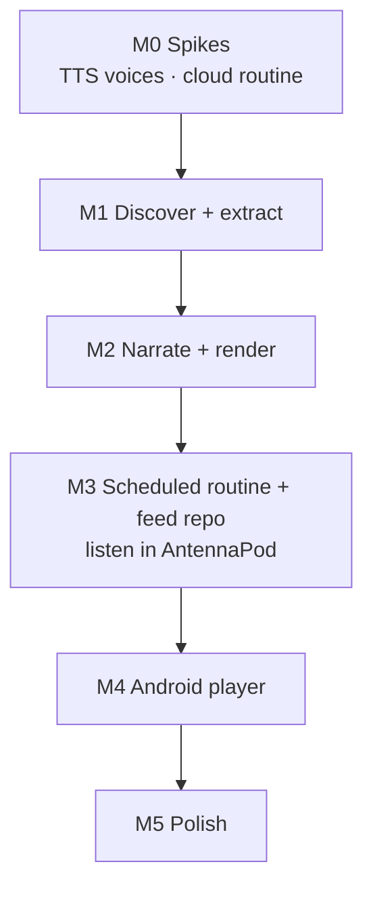

# Roadmap

Each milestone ends with something you can listen to. You'll have a working podcast in AntennaPod before the Android app is written.

## Milestones

### M0 — Spikes

**TTS voices.** Narrate one real Anthropic research post with each option, then compare quality, speed, and cost.

- Local models: Kokoro, Piper, and any newer open model worth a try.
- Paid APIs: ElevenLabs, OpenAI, Google Cloud TTS.
- Decision rule: use the local model if it sounds good enough. Otherwise use the best paid one.
- Also measure how long the local model takes on the routine's CPU.

**Cloud routine.** Check what the routine can actually do:

- Install Python dependencies and download a TTS model on each run, within the run's time limit.
- Push to a second private repo (`audio-presenter-feed`).
- Read a secret for a paid TTS key.
- Measure how much subscription usage one article costs.

### M1 — Discover and extract

- Sitemap, RSS, and listing adapters. `sources.yaml` with Anthropic research.
- Extraction to `article.json` with images downloaded.
- Run it locally and inspect the output.

### M2 — Narrate and render

- Narration skill and `script.json` schema.
- The TTS backend picked in M0.
- `presentation.json`, `chapters.json`, and validation.
- Run it locally from Claude Code, end to end, for one article.

### M3 — Scheduled routine

- Create the feed repo and the routine.
- `index.json`, `podcast.xml`, seen-URL state, retries, per-run cap.
- Subscribe in AntennaPod to check synced images in a real player.

### M4 — Android player

- Sync `index.json`, queue, offline downloads.
- Media3 playback with images in sync, chime and vibration cue, lock screen artwork.

### M5 — Polish

- Pause-on-media mode, transcript view, narration styles, per-source voices.
- Edit sources from the app.
- Android Auto.
- Feed repo retention cleanup.

## Open Questions

- **Can a routine work with two repos?** If not, the feed lives on an orphan `feed` branch of this repo. The M0 routine spike answers this.
- **Is a local model fast enough on the routine's CPU?** If not, that favors the paid API even if the local voice sounds fine.
- **Can AntennaPod read a private GitHub repo?** It doesn't support token auth. A private GitHub Pages site or a hard-to-guess raw URL may do. That only affects M3. Our app uses a token.
- **How often should the routine run?** Probably every few hours. It depends on the usage cost measured in M0.
