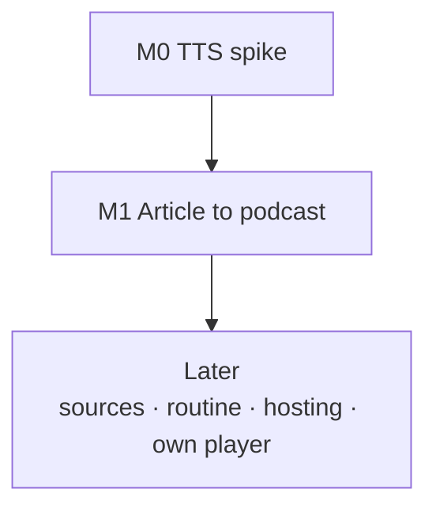

# Roadmap

The first goal is one article URL turned into one episode that plays in AntennaPod with images in sync. Sources, scheduling, hosting, and our own player wait until that works.

## M0 — TTS Spike

Pick the engine and voice. The plan is in [spikes/tts.md](spikes/tts.md).

## M1 — Article to Podcast

`/article-to-podcast <url>` in Claude Code produces an episode folder and an updated `podcast.xml`.

- Extract to `article.json`, with an extractor tested on 3 Anthropic research posts.
- Narration skill and `script.json` schema.
- Render with the spike's engine, chime, pauses, and loudness normalization.
- Package with ID3 chapters, `chapters.json`, `presentation.json`, `podcast.xml`.
- Listen to it in AntennaPod over the LAN.

**Done when** a real Anthropic post plays in AntennaPod, the images change at the right moments, and nothing has to be fixed by hand.

## Later

Not planned in detail yet:

- Sources and discovery, with the Anthropic sitemap first.
- A Claude Code cloud routine.
- Private hosting reachable from anywhere, so Pocket Casts also works.
- Our own player or an AntennaPod patch, if vibration or pause-on-media are missed.

## Open Questions

- **Does AntennaPod show ID3 chapter images from MP3s in a local folder,** or only from subscribed feeds? Test both ways in M1.
- **Is the chime enough of a cue?** Decide after a week of real listening.
- **How long should the pauses be** between segments, and before and after headings? Tune by ear in M1.
