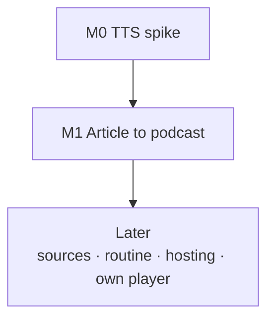

# Roadmap

The first goal is one article URL turned into one episode that plays in AntennaPod with images in sync. Sources, scheduling, hosting, and our own player wait until that works.

## M0 — TTS Spike

**Decided:** Kokoro `af_heart` is the default voice, with Qwen3-TTS `Ryan` as the male alternative. See [spikes/tts.md](spikes/tts.md).

## M1 — Article to Podcast

**Built.** `/article-to-podcast <url>` in Claude Code produces an episode and updates `podcast.xml`. The first episode is [harness-design-long-running-apps](https://www.anthropic.com/research/harness-design-long-running-apps): 34 minutes and 20 chapters.

Images change in sync in AntennaPod. But AntennaPod draws chapter art as a square with 32 dp margins and has no fullscreen view, so screenshots and charts are too small to read. That's what moves our own player forward.

Left to finish:

- Run the second test article, [formal-verification](https://www.anthropic.com/research/formal-verification), for its GIF, looping videos, and footnotes.

**Done when** a real Anthropic post plays in AntennaPod, the images change at the right moments, and nothing has to be fixed by hand.

## Later

Not planned in detail yet:

- Sources and discovery, with the Anthropic sitemap first.
- A Claude Code cloud routine.
- Private hosting reachable from anywhere, so Pocket Casts also works.
- Our own player or an AntennaPod patch, if vibration or pause-on-media are missed.

## Open Questions

- **Does AntennaPod show ID3 chapter images from MP3s in a local folder,** or only from subscribed feeds? Test both ways in M1.
- **Is the chime enough of a cue?** Decide after a week of real listening.
- **How long should the pauses be** between segments, and before and after headings? Tune by ear in M1.
- **Does AntennaPod show chapters in file order or by start time?** mutagen writes the `CHAP` frames out of order, but the `CTOC` list and start times are right.
