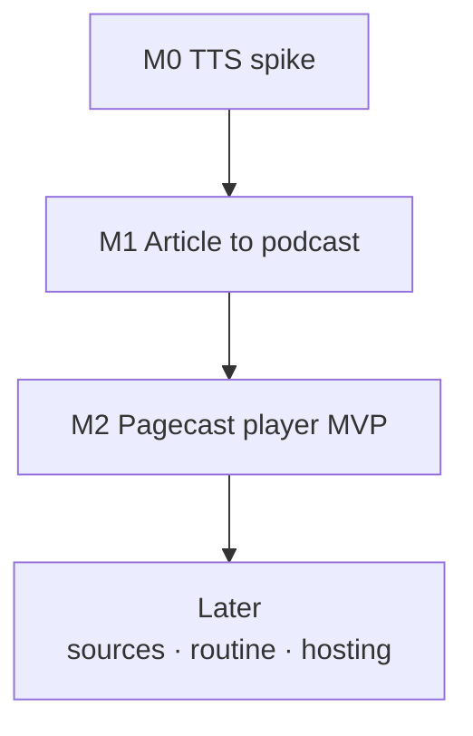

# Roadmap

The first goal is one article URL turned into one episode that plays with images in sync. Sources, scheduling, and hosting wait until that works.

## M0 — TTS Spike

**Decided:** Kokoro `af_heart` is the default voice, with Qwen3-TTS `Ryan` as the male alternative. See [spikes/tts.md](spikes/tts.md).

## M1 — Article to Podcast

**Built.** `/article-to-podcast <url>` in Claude Code produces an episode and updates `podcast.xml`. Test episodes: [harness-design-long-running-apps](https://www.anthropic.com/research/harness-design-long-running-apps) (34 minutes, 20 chapters) and a short cut of [formal-verification](https://www.anthropic.com/research/formal-verification) with four animations.

Images change in sync in AntennaPod. But AntennaPod draws chapter art as a square with 32 dp margins and has no fullscreen view, so screenshots and charts are too small to read. That's why M2 exists.

## M2 — Pagecast Player MVP

**Built** in [android/](../android). A prototype to try the experience, nothing more:

- Add a Pagecast feed by URL, then list and download its episodes for offline playback.
- Play, pause, stop, and resume where you left off. Playback continues in the background, with lock screen and Bluetooth controls.
- The current image fills the screen, and GIFs animate.
- Tapping shows the controls over the image: seek bar, back and forward 30 seconds, chapter list. They fade after 4 seconds of playback.

Not yet: vibration on new images, pause-on-media, zoom, a transcript, deleting old episodes automatically.

## Later

Not planned in detail yet:

- Sources and discovery, with the Anthropic sitemap first.
- A Claude Code cloud routine.
- Private hosting reachable from anywhere, so friends and Pocket Casts can use the feed.

## Open Questions

- **Is the chime enough of a cue?** Decide after a week of real listening.
- **How long should the pauses be** between segments, and before and after headings? Tune by ear.
- **Which frame should stand for an animation in other apps?** The last frame of a GIF is sometimes nearly empty, as in formal-verification's proof chart.
