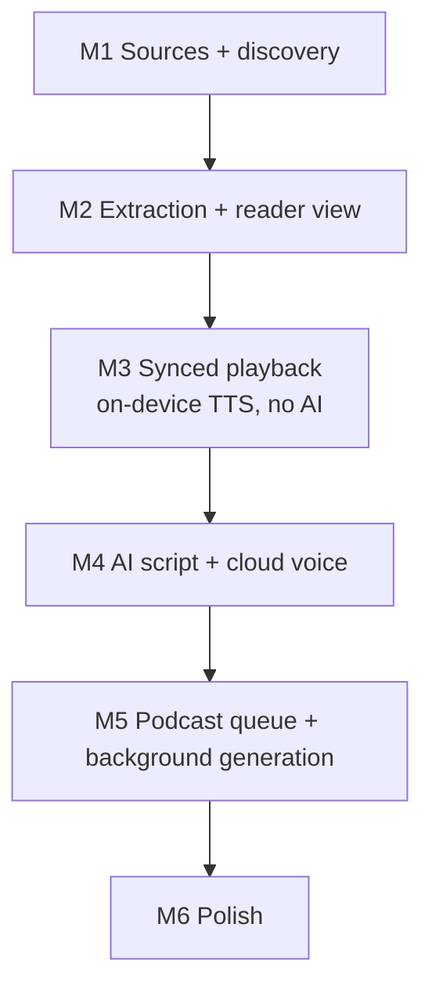

# Roadmap

Each milestone ends with something usable on the phone. The core experience, audio with synced images, gets proven with free on-device TTS before any paid AI is involved.

## Milestones

### M1 — Sources and discovery

- RSS, sitemap, and listing adapters, with auto-detection.
- Anthropic research preset.
- Source management screen and a list of discovered articles.

### M2 — Extraction

- HTML to ordered blocks, images downloaded.
- A plain reader view of the blocks to check extraction quality per source.

### M3 — Synced playback

- Read the blocks as-is with Android `TextToSpeech`, one segment per block.
- Media3 player, background playback, images in sync, chime and vibration cue.
- This is the milestone that tells us whether the idea works.

### M4 — AI narration

- Claude script builder: faithful adaptation, image descriptions through vision, media cues.
- Cloud TTS provider, with API keys entered in settings.

### M5 — Podcast experience

- Queue with auto-advance and played state.
- WorkManager chain: discover, extract, script, synthesize, notify.
- Storage cleanup.

### M6 — Polish

- Pause-on-media mode, narration styles, per-source voices.
- Android Auto.
- Transcript view.

## Open Questions

- **Which cloud TTS?** Voice quality vs cost per article. Compare a few providers on one real Anthropic post before M4.
- **Default narration style?** Planned as faithful. Confirm after hearing M4 output.
- **Cost guardrails?** Possibly a monthly cap, or a per-source "auto-generate" toggle so expensive sources only generate on demand.
- **Will Doze kill background generation?** If WorkManager proves unreliable for long jobs, consider a foreground service, or moving the pipeline to a server.
